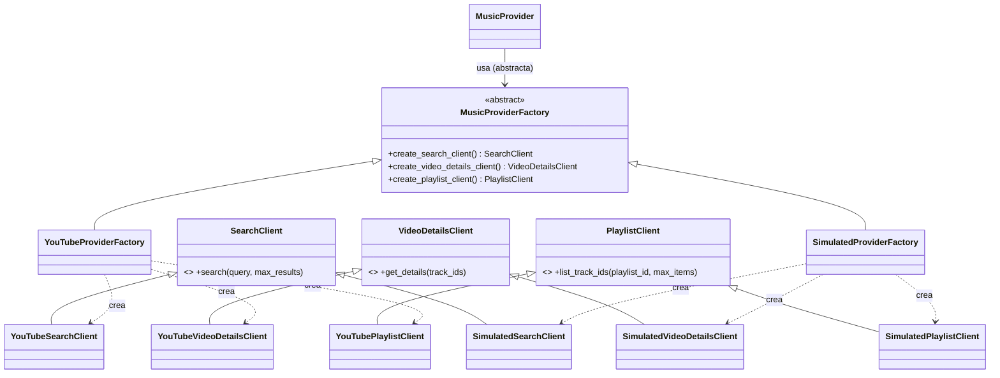

# Abstract Factory en Open Music UTP

## Problema
El catálogo necesita hablar con un proveedor de música, pero el SRS pide poder cambiarlo sin tocar el resto del sistema
(riesgo R-02) y probar sin gastar cuota (RNF-033, RNF-024). Además, los clientes del proveedor forman una **familia**:
búsqueda, detalles y playlists deben venir del mismo proveedor y compartir configuración.

## Solución


## Correspondencia con el patrón
| Rol del patrón | Clase | Archivo |
|---|---|---|
| Fábrica abstracta | `MusicProviderFactory` | `catalog/providers/base.py` |
| Fábricas concretas | `YouTubeProviderFactory`, `SimulatedProviderFactory` | `youtube/factory.py`, `simulated/factory.py` |
| Productos abstractos | `SearchClient`, `VideoDetailsClient`, `PlaylistClient` | `catalog/providers/base.py` |
| Productos concretos | `YouTube*Client`, `Simulated*Client` | `youtube/clients.py`, `simulated/clients.py` |
| Cliente | `MusicProvider` | `catalog/providers/music_provider.py` |
| Selección de fábrica | `build_provider_factory` | `catalog/providers/registry.py` |

## Puntos para la sustentación
1. `MusicProvider` nunca importa nada de YouTube: solo recibe una `MusicProviderFactory`.
2. Cambiar de proveedor es cambiar `MUSIC_PROVIDER` en el `.env` (`youtube` o `simulated`).
3. La familia es consistente: la fábrica de YouTube comparte un único recurso `youtube v3` entre sus tres productos.
4. Agregar un proveedor nuevo (p. ej. otro servicio) = una fábrica y tres clientes nuevos, sin modificar el código cliente (principio abierto/cerrado).
5. Las pruebas usan la familia simulada: cero cuota consumida (RNF-033).

## Costos de cuota (SRS 1.3.4)
`search.list` = 100 unidades · `videos.list` = 1 unidad por lote de hasta 50 ids · `playlistItems.list` = 1 unidad por página.
Con 10.000 unidades/día (A-03) caben ~100 búsquedas nuevas al día.

## Demo
```bash
cd backend
python -m scripts.demo_youtube --provider simulated search rock
python -m scripts.demo_youtube --provider youtube search "salsa"
python -m scripts.demo_youtube --provider youtube playlist <ID_DE_PLAYLIST>
```
